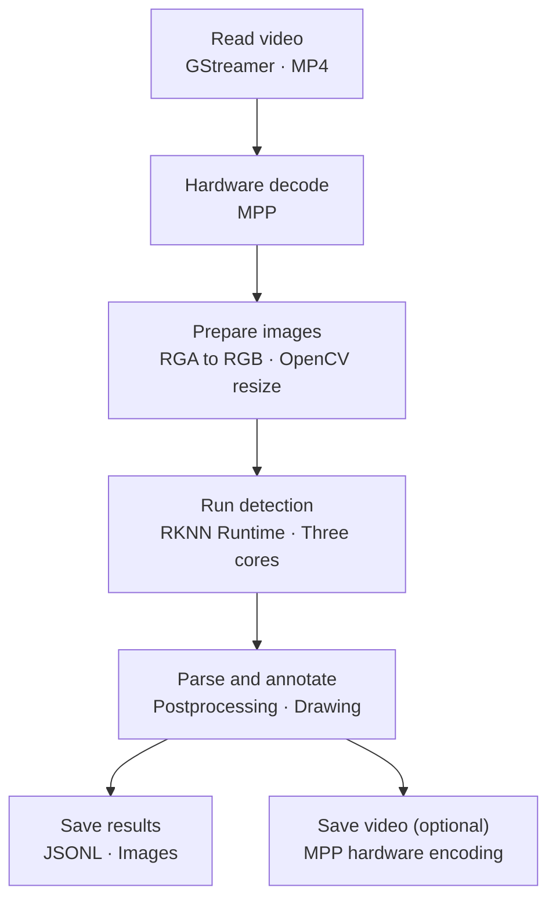

# Core3588E Video Interfaces

## Detection Results


These RTSP reference recordings show MPP hardware decoding and NPU inference. Both are 1080p MP4 outputs covering source frames 0–299, or 00:00–00:10. The annotated video uses 2-pixel boxes, 18-pixel Chinese labels, and confidence scores. The current SDK's parallel pipeline is described below.

### Annotated Video

<video controls preload="metadata" src="https://downloads.mixtile.com/core3588e/file/jetson-to-core3588e/videos/core3588e_detection_10s.mp4" poster="https://downloads.mixtile.com/core3588e/file/jetson-to-core3588e/images/core3588e_detection_preview.jpg" style={{width: '100%', maxWidth: '960px', maxHeight: '540px', display: 'block', margin: '1rem auto', background: '#111'}} />

### Unannotated Video

<video controls preload="metadata" src="https://downloads.mixtile.com/core3588e/file/jetson-to-core3588e/videos/core3588e_original_10s.mp4" style={{width: '100%', maxWidth: '960px', maxHeight: '540px', display: 'block', margin: '1rem auto', background: '#111'}} />

The unannotated video is re-encoded from the same decoded frames. The full source is about 11.37 seconds; see the [Jetson reference](/core-3588e/application-development/jetson-migration/video-pipeline/jetson/) for attribution and streaming commands.

## Run the Pipeline

Complete setup in the [Quick Start](/core-3588e/application-development/jetson-migration/implementation/quick-start/), then run from `demo-sdk/`. Stop any viewer already using port 8000 before starting the result server:

```bash
sudo ./benchmark/run.sh core int8 --encode && \
python3 -m http.server 8000 --bind 0.0.0.0 --directory results
```

Open `http://<Core3588E_IP>:8000/` and select the new run directory to view the annotated video, preview images, per-frame JSONL, and summary. Omit `--encode` for detection data and previews only. Add `--max` to use the highest supported clocks; the runner restores the original clock policy on exit.

## Current MP4 Pipeline



<div className="migration-table">

| Step | Interface and purpose |
| --- | --- |
| Decode | GStreamer `mppvideodec` uses MPP hardware decoding; native C APIs include `mpp_create`, `mpp_init`, `decode_put_packet`, and `decode_get_frame` |
| Prepare images | RGA `imcvtcolor` converts colors; OpenCV `resize` produces 640×640 input, matching the accuracy baseline |
| Run inference | Each NPU core has an independent context; `rknn_set_core_mask` selects the core, then `rknn_inputs_set` → `rknn_run` → `rknn_outputs_get` runs inference and retrieves outputs |
| Postprocess | Model Zoo detection-head decoding, confidence filtering, NMS, and mapping boxes to original-image coordinates |
| Video output | GStreamer `appsrc` → NV12 → `mpph264enc` → `h264parse` → `mp4mux`; MPP performs hardware H.264 encoding |

</div>

The model's conversion settings include mean=0 and std=255. Submit RGB UINT8 pixels without dividing by 255 again. Each NPU core processes a separate frame to increase aggregate throughput. The pipeline still performs buffer copies; it is not zero-copy. See [Performance and Value](/core-3588e/application-development/jetson-migration/performance-benchmark/) for test conditions.

## RTSP Reference

The single-instance RTSP example demonstrates stream input, frame access, and saving both original and annotated video. Its throughput differs from the three-core MP4 benchmark.

```bash
cd video
sudo ./run_core.sh --rtsp "rtsp://<AMD_IP>:8554/supermarket" --output "$PWD/results/demo" && \
python3 -m http.server 8001 --bind 0.0.0.0 --directory results
```

The output directory must be new. Open `http://<Core3588E_IP>:8001/` for `original.mp4`, `annotated.mp4`, `detections.jsonl`, and `summary.json`. Successful runs report `status=complete`.

`RGBReader` uses `rtspsrc → rtph264depay → h264parse → mppvideodec → videoconvert → appsink` to read RGB frames using the buffer's stride and offset. `rknn_detector.Detector` runs inference and returns detections. Two `appsrc` pipelines save original and annotated frames; both use MPP hardware encoding in the current SDK.

## Standalone Hardware Examples

<div className="migration-table">

| What to test | Guide |
| --- | --- |
| MP4 / RTSP hardware decoding and the MPP C API | [MPP Hardware Decoding](/core-3588e/application-development/jetson-migration/video-pipeline/core3588e/mpp/) |
| RGA resize, crop, rotation, and color conversion | [RGA Image Processing](/core-3588e/application-development/jetson-migration/video-pipeline/core3588e/rga/) |

</div>

Source directories are `benchmark/core/`, `video/`, and `hardware/public/`; all use `core3588e/runtime:2.5.0-arm64`.

Official APIs: [MPP](https://github.com/rockchip-linux/mpp) · [RGA](https://github.com/airockchip/librga) · [RKNN Runtime](https://github.com/airockchip/rknn-toolkit2/tree/master/rknpu2) · [GStreamer appsink](https://gstreamer.freedesktop.org/documentation/app/appsink.html)
