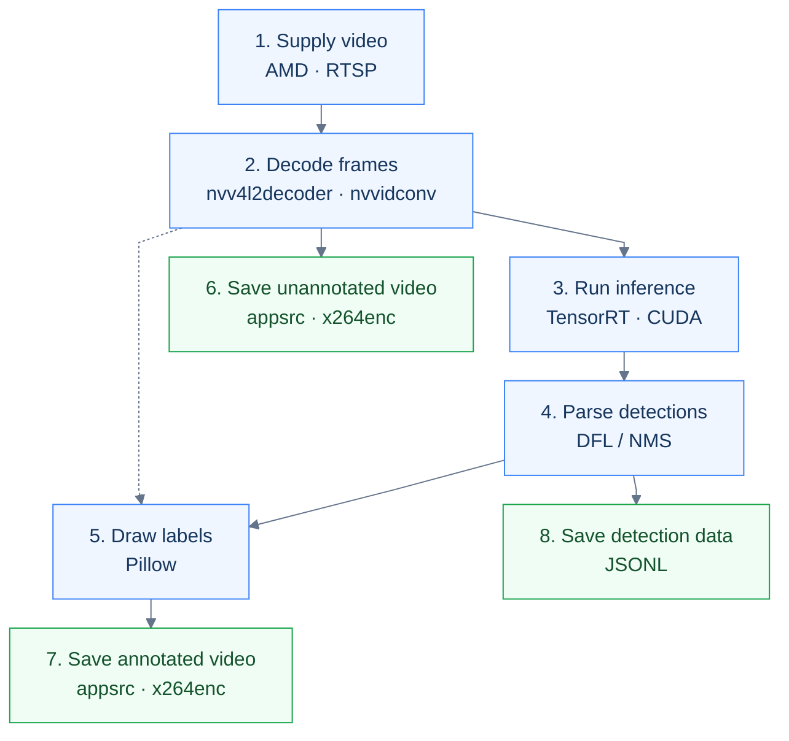

# Jetson Video Interfaces

Environment and source: [Quick Start: Docker + Demo SDK](/core-3588e/application-development/jetson-migration/implementation/quick-start/).

The videos below are from the original RTSP demo and retain its Chinese labels. The current SDK generates English labels and result pages. For current MP4 benchmarks, see [Performance and Value](/core-3588e/application-development/jetson-migration/performance-benchmark/).

## Current benchmark command

Run the current MP4 benchmark in Jetson's native JetPack environment. Build the engine locally from the shared ONNX model:

```bash
cd demo-sdk
sudo ./benchmark/run.sh jetson fp16 --max --encode \
  --model /absolute/yolov8n_fp16.engine
```

The default configuration uses four inference instances, CUDA Graph, and GPU preprocessing and detection-head decoding. The CPU performs NMS and draws annotations in the affected image regions. Omit `--encode` for detection data and previews only. Results are saved in `results/benchmark-*/`. The runner restores the power mode, clocks, and fan service on completion or failure. The RTSP reference below uses a different drawing and dual-video encoding pipeline, so its throughput differs from the MP4 benchmark.

## Supermarket detection results


Middle-frame preview: 2-pixel boxes, 18-pixel Chinese labels and confidence scores. Boxes are mapped back to the original 1080p frame.

Jetson Orin Nano processes the supermarket RTSP stream frame by frame and produces the two videos below as the migration baseline. These are the original 1080p MP4 outputs, with no additional compression for this page.

### Detection video (10 seconds)

<video controls preload="metadata" src="https://downloads.mixtile.com/core3588e/file/jetson-to-core3588e/videos/supermarket_detection_10s.mp4" poster="https://downloads.mixtile.com/core3588e/file/jetson-to-core3588e/images/supermarket_detection_preview.jpg" style={{width: '100%', maxWidth: '960px', maxHeight: '540px', display: 'block', margin: '1rem auto', background: '#111'}} />

### Unannotated video: the same 300 frames

<video controls preload="metadata" src="https://downloads.mixtile.com/core3588e/file/jetson-to-core3588e/videos/supermarket_original_10s.mp4" style={{width: '100%', maxWidth: '960px', maxHeight: '540px', display: 'block', margin: '1rem auto', background: '#111'}} />

Both videos cover `00:00.000–00:10.000` of the source, frames 0–299. The unannotated video is re-encoded after RTSP decoding. The full source is approximately 11.37 seconds: [Pexels original](https://www.pexels.com/video/customers-shopping-at-supermarket-10901926/) by Suika Chan; [media license](https://www.pexels.com/license/).

### Recorded results

<div className="migration-table">

| Item | Measurement |
| --- | --- |
| Status | `complete`; 300 frames processed individually |
| Both output videos | H.264 / MP4, 1920×1080, 30 FPS, 10.000 seconds |
| Total processing time | 33.87 seconds for initialization, warm-up, processing, both encoders through EOS and cleanup; final file verification excluded |
| Average per-frame detection time | 45.61 ms, including resizing, normalization, data transfers, TensorRT, and postprocessing |
| Detection data | Original-image xyxy coordinates, model coordinates, class, confidence, source PTS and output timestamps |

</div>

The videos play at 30 FPS. This reference pipeline processed approximately 8.86 frames per second, including initialization and cleanup, so it did not achieve real-time 30 FPS. The stream and output videos contain no audio; the example does not include tracking or alerts.

Source code is in `demo-sdk/jetson/`; reference videos are in `demo-sdk/videos/reference-output/`. Prepare the JetPack / TensorRT environment, then follow the working-directory instructions for each command below.

## Hardware and software interfaces

`nvv4l2decoder` uses the video-decoding hardware, `nvvidconv` converts buffers, and TensorRT/CUDA runs GPU inference. The CPU handles frame access, resizing, postprocessing, Pillow drawing and x264 encoding. This reference pipeline includes CPU processing and memory copies.

## Eight steps from video to results



The numbers match the steps below. Frames from step 2 and boxes from step 4 are combined in step 5.

## Run the full pipeline

Complete step 1 on the AMD host first. Jetson uses its native JetPack / TensorRT environment. Extract Demo SDK and replace `/absolute/extracted/path` with its location. The SDK does not include a Jetson engine: build one on the target Jetson from the bundled ONNX model, then run steps 2–8.

```bash
cd /absolute/extracted/path/demo-sdk/jetson
mkdir -p ../models
/usr/src/tensorrt/bin/trtexec --onnx=../model-conversion/model.onnx \
  --saveEngine=../models/yolov8n_jp7_fp16.engine --fp16 --skipInference

for plugin in rtspsrc rtph264depay h264parse nvv4l2decoder nvvidconv videoconvert appsink appsrc x264enc mp4mux; do
  gst-inspect-1.0 "$plugin" >/dev/null || exit 1
done
/usr/bin/python3 -c 'import cv2, PIL, tensorrt'
export AMD_IP='<RTSP_SERVER_IP>'
bash run_supermarket.sh --engine "$PWD/../models/yolov8n_jp7_fp16.engine" --rtsp "rtsp://${AMD_IP}:8554/supermarket" --frames 300 --fps 30
```

Set `AMD_IP` to the video-source address. `--engine` selects the model built above. After `Completed: 300 frames / 10.000 seconds of video`, open the generated `results/supermarket-*/` directory for both videos, JSONL, the summary and first/middle/last-frame previews.

## Interfaces used in each step

### 1. Supply video

On the AMD host, run `serve_supermarket.py` from the SDK's `jetson/` directory. Install FFmpeg, GStreamer RTSP Server, and Python GObject Introspection bindings (GI) first. Place the full source video there as `supermarket_full_original.mp4`, then run:

```bash
ffmpeg -n -i supermarket_full_original.mp4 \
  -map 0:v:0 -an -c:v libx264 -preset fast -crf 18 \
  -pix_fmt yuv420p -bf 0 -g 30 -keyint_min 30 -sc_threshold 0 \
  -r 30 -video_track_timescale 90000 -movflags +faststart \
  supermarket_rtsp_1080p30.mp4

/usr/bin/python3 serve_supermarket.py \
  --video "$PWD/supermarket_rtsp_1080p30.mp4" \
  --port 8554
```

`GstRtspServer` mounts `/supermarket`. Each connection starts at the beginning of the source and stops at the end without looping.

### 2. Decode frames with Jetson video hardware

`nvv4l2decoder` sends the compressed stream to NVIDIA's video-decoding hardware. `nvvidconv` converts the decoded buffer to full-resolution BGRx; the generic `videoconvert` then converts it to RGB.

First verify decoding and image format on Jetson:

```bash
export AMD_IP='<AMD_IP>'

gst-launch-1.0 -e -v \
  rtspsrc location="rtsp://${AMD_IP}:8554/supermarket" protocols=tcp latency=200 \
  ! 'application/x-rtp,media=video,encoding-name=H264' \
  ! rtph264depay ! h264parse ! nvv4l2decoder \
  ! nvvidconv ! 'video/x-raw,format=BGRx' \
  ! videoconvert ! 'video/x-raw,format=RGB' \
  ! identity eos-after=150 ! fakesink sync=false
```

Check that the negotiated GStreamer capabilities (caps) report RGB at 1920×1080 and that end-of-stream (EOS) is received. The main application replaces `fakesink` with `appsink` to read frames through these interfaces:

<div className="migration-table">

| Interface | Use |
| --- | --- |
| `sink.emit('try-pull-sample', timeout_ns)` | Retrieve a `GstSample`; check bus messages on timeout or EOS |
| `sample.get_caps()`, `GstVideo.VideoInfo.new_from_caps(caps)` | Read width, height and layout |
| `sample.get_buffer()`, `buffer.pts` | Access the pixel buffer and presentation timestamp (PTS) |
| `GstVideo.buffer_get_video_meta(buffer)` | Read actual offset / stride; fall back to VideoInfo if metadata is absent |
| `buffer.map(Gst.MapFlags.READ)` → NumPy `.copy()` → `buffer.unmap()` | Copy an independent RGB array using the actual row stride, then unmap |

</div>

The application receives an `H×W×3`, `uint8` RGB array. Respect the actual row stride and copy any data needed after unmapping. [GStreamer appsink](https://gstreamer.freedesktop.org/documentation/app/appsink.html)

### 3. Run inference with TensorRT / CUDA

`trt_detector.py` is the demo wrapper around NVIDIA's official SDK. OpenCV resizes directly to 640×640 on the CPU, and NumPy prepares `[1,3,640,640]` FP32 NCHW input before GPU execution:

<div className="migration-table">

| Official interface | Use |
| --- | --- |
| `trt.Runtime(logger)`, `deserialize_cuda_engine(engine_bytes)` | Load the locally built engine at initialization |
| `engine.create_execution_context()` | Create a reusable execution context |
| `get_tensor_name`, `get_tensor_mode`, `get_tensor_shape`, `get_tensor_dtype` | Query input/output tensor names, roles, shapes, and data types |
| `cudaMalloc`, `context.set_tensor_address(name, ptr)` | Allocate GPU buffers and bind tensor addresses at initialization |
| `cudaMemcpy(..., cudaMemcpyHostToDevice)` | Copy each CPU input to the GPU (H2D) |
| `context.execute_async_v3(0)` | Submit inference on the default CUDA stream |
| `cudaDeviceSynchronize()`, D2H `cudaMemcpy` | Wait for completion, then copy all nine outputs to the CPU |
| `cudaFree(ptr)` | Release buffers when closing the detector |

</div>

Python `ctypes` calls the CUDA Runtime C API. Copy-direction values are 1 for host-to-device (H2D) and 2 for device-to-host (D2H). This reference implementation synchronizes every frame. FP32 is the input tensor's data type; individual operators may use other precisions. [TensorRT 10.x API](https://docs.nvidia.com/deeplearning/tensorrt/10.x.x/inference-library/python-api-docs.html) · [CUDA memory API](https://docs.nvidia.com/cuda/cuda-runtime-api/cuda_runtime_api/group__CUDART__MEMORY.html) · [CUDA synchronization API](https://docs.nvidia.com/cuda/cuda-runtime-api/cuda_runtime_api/group__CUDART__DEVICE.html)

From the example directory, pass the `rgb` frame from step 2:

```python
from trt_detector import Detector  # Demo wrapper around the NVIDIA APIs shown above.

detector = Detector("../models/yolov8n_jp7_fp16.engine")
try:
    detections = detector.infer(rgb)  # Includes inference and the postprocessing from step 4.
finally:
    detector.close()
```

This wrapper expects the fixed nine-output YOLOv8n model. When replacing the engine, update the input/output handling and postprocessing together.

### 4. Parse tensors into detections

TensorRT returns output tensors. `cpp_backend.postprocess` calls the demo's native library through ctypes to filter candidates, decode box distributions (DFL), and perform per-class non-maximum suppression (NMS) on the CPU. It preserves NumPy ordering for tied scores to match earlier results. This function is part of the demo, not an NVIDIA API. On first use, `build_cpp.sh` compiles it with g++:

```python
from cpp_backend import postprocess

detections = postprocess(outputs, threshold=0.25, nms_threshold=0.45)
```

`Detector.infer()` already calls this function. Outputs are ordered by the 80 / 40 / 20 scales, with 64 / 80 / 1 channels per scale; this implementation uses the first two tensor groups per scale. Each result contains `class_id`, `confidence` and a `box` in 640×640 model coordinates, before any drawing.

### 5. Draw detections on the original image

`detection_overlay.py` uses third-party Pillow drawing on the CPU. `COCO80` maps class IDs to English names; `ImageDraw.rectangle` draws 2-pixel boxes, and `ImageDraw.text` draws 18-pixel labels and confidence scores:

```python
from detection_overlay import draw_detections

annotated_bgr = draw_detections(rgb, detections, frame_id, source_elapsed_ns)
```

The function maps boxes with `x_original=x_model×original_width/640` and `y_original=y_model×original_height/640`, returning an independent, full-resolution BGR array. `frame_id` starts at 0; `source_elapsed_ns` is the current PTS minus the first PTS in integer nanoseconds. The timecode font size is 12. These formulas apply to direct resizing; letterboxed input requires padding removal first. [Pillow drawing API](https://pillow.readthedocs.io/en/stable/reference/ImageDraw.html)

### 6. Save unannotated video through appsrc

Convert the unannotated frame from step 2 to BGR. Create a `GstBuffer`, fill its pixels, set PTS / DTS / duration, then call `appsrc.emit('push-buffer', buffer)`:

```text
appsrc (BGR, 1920×1080, 30/1) → queue → videoconvert → I420
→ x264enc tune=zerolatency speed-preset=veryfast
   bitrate=6000 bframes=0 key-int-max=30
→ h264parse → mp4mux faststart=true → filesink
```

This pipeline produces `original.mp4` using CPU software encoding with `x264enc`. Orin Nano has no NVENC hardware video encoder. [appsrc API](https://gstreamer.freedesktop.org/documentation/app/appsrc.html) · [NVIDIA Orin Nano software encoding](https://docs.nvidia.com/jetson/archives/r39.2.1/DeveloperGuide/SD/Multimedia/SoftwareEncodeInOrinNano.html)

### 7. Save annotated video through appsrc

Send the annotated BGR frames from step 5 through a second identical pipeline to create `annotated.mp4`. Both outputs use the same frames and encoding timestamps. Send `end-of-stream` and wait for EOS to finalize the MP4 files. Both videos are 1920×1080, 30 FPS and 10 seconds long.

### 8. Save detection data for the application

The main program writes one `json.dumps` record per frame to `detections.jsonl`, including class, confidence, model and original-image coordinates, source PTS and processing time. `source_time_seconds` is relative source time; `output_time_seconds=frame_id/fps` is output-video time. Use these detections for counting, alerts or business APIs.

## Process a single image

`cv2.imread` decodes the image on the CPU. Convert it to RGB and reuse the same TensorRT detector, bypassing RTSP and video decoding. Place `input.jpg` in the deployed example directory, then run:

```bash
cd /absolute/extracted/path/demo-sdk/jetson

env -u PYTHONPATH -u LD_LIBRARY_PATH /usr/bin/python3 - <<'PY'
import cv2
from trt_detector import Detector
from detection_overlay import configure, draw_detections

bgr = cv2.imread("input.jpg")
if bgr is None:
    raise FileNotFoundError("Cannot read input.jpg")
rgb = cv2.cvtColor(bgr, cv2.COLOR_BGR2RGB)
configure(font_size=18, box_width=2)
detector = Detector("../models/yolov8n_jp7_fp16.engine")
try:
    detections = detector.infer(rgb)
    image = draw_detections(rgb, detections, 0, 0)
    if not cv2.imwrite("image-result.jpg", image):
        raise RuntimeError("Failed to save the annotated image.")
    print("Detections:", len(detections))
finally:
    detector.close()
PY
```

Open `image-result.jpg`. Frame ID and timecode are both 0 in this example; inference and box-coordinate mapping are the same as video steps 3–5.

## Official DeepStream interface reference

DeepStream provides another official integration path. <strong>The SDK is installed, but this pipeline has not been validated</strong> in this project. Select a version compatible with JetPack / CUDA / TensorRT before deployment.

<div className="migration-table">

| Function | Official component / interface | Use |
| --- | --- | --- |
| Batching and metadata | `nvstreammux`, `NvDsBatchMeta` | Organize inputs into video buffers with batch metadata |
| Step 3: inference | `nvinfer` | Run preprocessing and TensorRT inference, then attach object metadata according to the model configuration |
| Step 4: output parsing | `NvDsInferParseCustomFunc`, `NvDsInferObjectDetectionInfo` | Implement and compile a model-specific parser; read the nine outputs by name and shape to return classes, scores and boxes |
| Step 5: annotation | `NvDsObjectMeta`, `nvdsosd` | Set `rect_params` and `text_params` in a pad probe, such as border width 2 and font size 18; the plugin renders them |

</div>

For example, after obtaining an `NvDsObjectMeta* obj` while iterating metadata:

```cpp
obj->rect_params.border_width = 2;
obj->text_params.font_params.font_size = 18;
```

Start from the official `deepstream-test3` RTSP example and organize the pipeline as `nvstreammux → nvinfer → color conversion → nvdsosd`. Match the parser, model and label files. Use `cluster-mode=2` when the plugin performs NMS, or `cluster-mode=4` when the parser has already done it. DeepStream requires its video buffers and metadata; the CPU NumPy frames above need an integration layer.

References: [Official samples](https://docs.nvidia.com/deepstream/text/DS_C_Sample_Apps) · [Custom model parsing](https://docs.nvidia.com/deepstream/text/DS_using_custom_model) · [nvinfer configuration](https://docs.nvidia.com/deepstream/text/DS_plugin_gst-nvinfer) · [nvdsosd](https://docs.nvidia.com/deepstream/text/DS_plugin_gst-nvdsosd) · [Object metadata](https://docs.nvidia.com/metropolis/deepstream/dev-guide/sdk-api/struct__NvDsObjectMeta.html)

## Check and download results

- The summary should report `status=complete` and `processed_frames=300`.
- Check frame counts, dimensions and first/middle/last frames in both MP4 files.
- Source PTS values in JSONL should increase; detection `box` values use original-image xyxy coordinates.
- For `incomplete` or `.partial.mp4` outputs, inspect `error` in the summary first.

On your computer, replace `<JETSON_USER>` and `<JETSON_IP>`, then download:

```bash
scp -r \
  '<JETSON_USER>@<JETSON_IP>:/absolute/extracted/path/demo-sdk/jetson/results/supermarket-*' \
  ~/Downloads/
```
